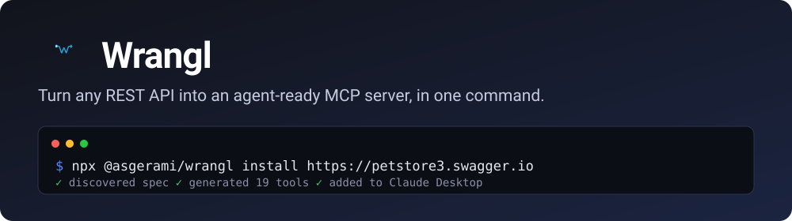
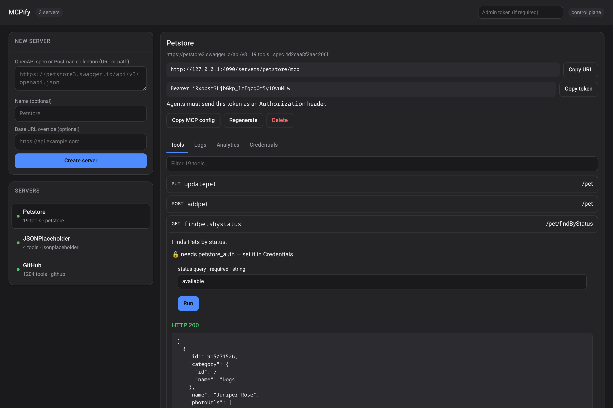
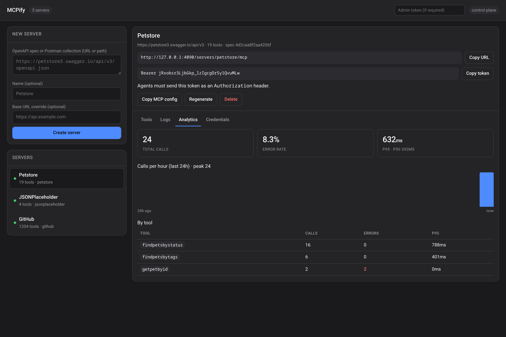
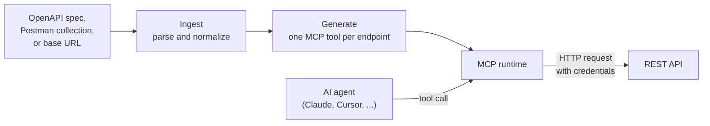

<p align="center">
  
</p>

<p align="center">
  <a href="https://github.com/asgerami/wrangl/actions/workflows/ci.yml"></a>
  <a href="https://www.npmjs.com/package/@asgerami/wrangl"></a>
  
  = 22" />
  <a href="LICENSE"></a>
</p>

<p align="center"><b>Your AI agent can't use your APIs. Wrangl fixes that in one command.</b></p>

AI agents like Claude and Cursor call tools through the
[Model Context Protocol (MCP)](https://modelcontextprotocol.io), but most APIs
only speak REST. Wrangl connects the two. Give it an OpenAPI spec, a Postman
collection, or just a base URL, and it generates a working MCP server where
every endpoint is a tool the agent can call. Your API keys stay on the server
and are added to each request there, so the agent never sees them.

Wrangl ships as a CLI on npm, a self-hosted server with a web dashboard, and a
TypeScript library.

<p align="center">
  
</p>

## Contents

- [Quick start](#quick-start)
- [Features](#features)
- [How it works](#how-it-works)
- [Tech stack](#tech-stack)
- [Engineering notes](#engineering-notes)
- [Testing](#testing)
- [Project structure](#project-structure)
- [Documentation](#documentation)

## Quick start

Requires **Node 22 or newer**.

```bash
# Point Wrangl at an API. It finds the spec, generates the tools, and adds the
# server to Claude Desktop. Restart Claude and the API is ready to use.
npx @asgerami/wrangl install https://petstore3.swagger.io

# No spec? Pick a ready-made server from the catalog.
npx @asgerami/wrangl catalog                         # list them
npx @asgerami/wrangl add stripe                      # 587 tools
npx @asgerami/wrangl add github --include "repos*"   # just part of a big API

# Prefer a UI? Start the dashboard to create, test, and monitor servers.
npx @asgerami/wrangl serve                           # http://localhost:4000
```

Add `--client cursor|windsurf|cline|zed|vscode` to target a different agent.

### From source

```bash
git clone https://github.com/asgerami/wrangl.git
cd wrangl
npm install
npm run build
npm start -- install https://petstore3.swagger.io
```

### With Docker

```bash
cp .env.example .env        # set WRANGL_SECRET_KEY and WRANGL_ADMIN_TOKEN
docker compose up -d --build
# dashboard and API on http://localhost:4000
```

## Features

- **One command to a working tool.** `install` finds the spec, generates the
  tools, and writes the server into your agent's config file. Existing servers
  are kept and the file is backed up first.
- **Built-in catalog.** Ready-made servers for GitHub, Stripe, OpenAI, Twilio,
  Discord, Slack, SendGrid, and PagerDuty, so you don't have to track down a
  spec.
- **Spec auto-discovery.** Given a bare base URL, Wrangl tries the usual spec
  paths. If none work, it reads the API's docs page and follows the spec link.
- **Handles real-world specs.** OpenAPI 3.x and Postman collections, including
  recursive schemas, relative server URLs, and unusual parameter styles.
  `--include` / `--exclude` trim huge APIs (GitHub has 1,200+ endpoints) down
  to the tools an agent needs.
- **Auth built in.** Bearer, Basic, API key, OAuth2 (authorization code with
  PKCE, and client credentials), and OpenID Connect discovery.
- **Web dashboard.** Create servers, run any tool from the browser, read
  request and response logs, and see per-tool call counts, error rates, and
  latency.
- **Ready to deploy.** Docker image, admin auth, per-server tokens and rate
  limits, retries with backoff, and a PostgreSQL backend for running several
  replicas.
- **Up to date with MCP.** Targets the current protocol revision
  (`2026-07-28`) and still serves older clients. Destructive tools (`DELETE` by
  default) ask the agent to confirm before they run.
- **Optional LLM pass.** `--enrich` sends the generated tools to the Claude API
  and rewrites raw names like `post_v1_contacts` into clear names and
  descriptions, so agents pick the right tool more often.

<p align="center">
  
</p>

## How it works



1. **Ingest** ([`src/parser`](src/parser/)). Load and validate the spec, or
   discover it from a base URL. Postman collections are converted to OpenAPI,
   then everything is normalized into one internal model.
2. **Generate** ([`src/generator`](src/generator/)). Each operation becomes an
   MCP tool. JSON Schemas are converted to Zod schemas for input validation,
   and the HTTP method sets the tool's hints (read-only, destructive,
   idempotent).
3. **Run** ([`src/runtime`](src/runtime/)). Serve the tools over stdio or HTTP.
   When the agent calls a tool, Wrangl builds the real HTTP request, adds the
   credentials, calls the API, and returns the response.

The control plane ([`src/controlplane`](src/controlplane/)) wraps all of this
in a Fastify server that hosts many generated servers at once, with a REST API,
the dashboard, encrypted credential storage, and OAuth.

## Tech stack

| Area | Tools |
| --- | --- |
| Language | TypeScript (strict mode), Node.js 22+, ES modules |
| Server | Fastify 5, official MCP TypeScript SDK |
| Validation | Zod 4, swagger-parser |
| Database | SQLite (`node:sqlite`) for a single instance, PostgreSQL for multiple replicas |
| AI | Claude API with structured outputs (optional enrichment pass) |
| Frontend | Single-file dashboard in HTML, CSS, and vanilla JavaScript |
| DevOps | Docker (multi-stage, non-root), Docker Compose, GitHub Actions |
| Testing | Node's built-in test runner (`node:test`) with `tsx` |

## Engineering notes

A few of the design decisions behind the code:

- **Credentials never reach the agent.** Stored credentials are encrypted at
  rest with AES-256-GCM ([`vault.ts`](src/controlplane/vault.ts)) and decrypted
  only in memory when the proxy builds a request. The agent only sees the tool
  and its result.
- **Retries that can't repeat a write.** Network errors and 5xx responses are
  retried with exponential backoff, but only for idempotent methods (GET, HEAD,
  OPTIONS, PUT, DELETE). POST and PATCH are never retried, so a lost response
  can't cause a write to run twice ([`proxy.ts`](src/runtime/proxy.ts)).
- **Confirmations that can't be replayed.** Before a destructive tool runs, the
  agent has to confirm. The confirmation token is HMAC-signed and bound to a
  hash of the exact arguments, so it can't be reused for a different call, and
  expired or tampered tokens are rejected
  ([`confirmation.ts`](src/runtime/confirmation.ts)).
- **One storage interface, two backends.** Servers, credentials, and usage logs
  go through small store interfaces with SQLite and PostgreSQL implementations.
  An integration test runs two registries against one Postgres database to
  check they stay in sync like real replicas
  ([`store.ts`](src/controlplane/store.ts),
  [`store-postgres.ts`](src/controlplane/store-postgres.ts)).
- **Recursive schemas don't crash it.** Specs like Stripe's and GitHub's
  contain schemas that reference themselves. The generator cuts those cycles so
  every tool schema is a finite, JSON-serializable tree
  ([`tools.ts`](src/generator/tools.ts)).
- **Live reload.** With `--watch`, Wrangl re-reads the spec on an interval,
  diffs the old and new tool sets, and updates the running server without a
  restart ([`diff.ts`](src/generator/diff.ts),
  [`watch.ts`](src/runtime/watch.ts)).

## Testing

```bash
npm run typecheck                  # tsc --noEmit
npm test                           # full suite
WRANGL_SKIP_NETWORK=1 npm test     # skip tests that call public APIs
```

- **140+ tests across 31 files:** unit tests, end-to-end tests that connect a
  real MCP client to a generated server, OAuth flow tests, PostgreSQL
  integration tests, and ingestion tests against real public specs (Petstore,
  GitHub, Stripe, Discord, and more).
- **CI** runs typecheck, build, and tests on Node 22 and 24 for every push and
  pull request, plus a job against a real PostgreSQL 16 service.
- **A nightly workflow** runs the network tests against the live APIs to catch
  upstream spec changes early.
- **Releases** are published to npm with provenance from GitHub Actions when a
  version tag is pushed.

## Project structure

```text
src/
  parser/        Load, validate, and discover specs (OpenAPI, Postman)
  generator/     Endpoints to MCP tools: schema conversion, filters, LLM enrichment
  runtime/       MCP server, HTTP proxy, auth injection, confirmations, live reload
  controlplane/  Fastify REST API, dashboard, storage, credential vault, OAuth
  cli.ts         The `wrangl` command
  index.ts       Library entry point
test/            Unit, integration, and end-to-end tests
prebuilt/        Catalog manifest and bundled specs
examples/        Sample specs to try
docs/            Full guide and images
```

## Documentation

The full reference is in **[docs/GUIDE.md](docs/GUIDE.md)**:

- Every CLI command and flag
- Connecting to each agent client and filtering large APIs
- Authentication and the OAuth2 flow
- Semantic enrichment, auto-discovery, live spec sync, and usage logs
- The hosted control plane, dashboard, and REST API
- Securing and deploying (Docker, TLS, PostgreSQL for multiple replicas)
- Using Wrangl as a library

Release history is in [CHANGELOG.md](CHANGELOG.md).

## License

[MIT](LICENSE) © [asgerami](https://github.com/asgerami)
