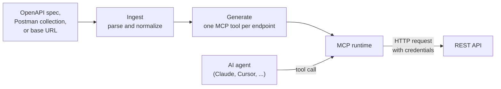

# Architecture

How Wrangl is put together, and the design decisions behind it. For using
Wrangl, see the [README](../README.md) and the [Guide](GUIDE.md).

## Overview

1. **Ingest** ([`src/parser`](../src/parser/)). Load and validate the spec,
   or discover it from a base URL. Postman collections are converted to
   OpenAPI, then everything is normalized into one internal model.
2. **Generate** ([`src/generator`](../src/generator/)). Each operation
   becomes an MCP tool. JSON Schemas are converted to Zod schemas for input
   validation, and the HTTP method sets the tool's hints (read-only,
   destructive, idempotent).
3. **Run** ([`src/runtime`](../src/runtime/)). Serve the tools over stdio or
   HTTP. When the agent calls a tool, Wrangl builds the real HTTP request,
   adds the credentials, calls the API, and returns the response.

The control plane ([`src/controlplane`](../src/controlplane/)) wraps all of
this in a Fastify server that hosts many generated servers at once, with a
REST API, the dashboard, encrypted credential storage, and OAuth.

The [Guide](GUIDE.md#project-layout) maps every source file.

## Design decisions

- **Credentials never reach the agent.** Stored credentials are encrypted at
  rest with AES-256-GCM ([`vault.ts`](../src/controlplane/vault.ts)) and
  decrypted only in memory when the proxy builds a request. The agent only
  sees the tool and its result, and request logs record the URL with any
  query-string credentials stripped.
- **Retries that can't repeat a write.** Network errors, timeouts, and 5xx
  responses are retried with exponential backoff, but only for idempotent
  methods (GET, HEAD, OPTIONS, PUT, DELETE). POST and PATCH are sent once,
  so a lost response can't cause a write to run twice
  ([`proxy.ts`](../src/runtime/proxy.ts)).
- **Arguments can't redirect a call.** A path parameter of `.` or `..` would
  be resolved away by URL parsing and land the request on a different
  endpoint, credentials attached. The proxy rejects such values before
  anything is sent.
- **Confirmations that can't be replayed.** Before a destructive tool runs,
  the agent has to confirm. The confirmation token is HMAC-signed and bound
  to a hash of the exact arguments, so it can't be reused for a different
  call, and expired or tampered tokens are rejected
  ([`confirmation.ts`](../src/runtime/confirmation.ts)).
- **One storage interface, two backends.** Servers, credentials, and usage
  logs go through small store interfaces with SQLite and PostgreSQL
  implementations. An integration test runs two registries against one
  Postgres database to check they stay in sync like real replicas
  ([`store.ts`](../src/controlplane/store.ts),
  [`store-postgres.ts`](../src/controlplane/store-postgres.ts)).
- **Recursive schemas don't crash it.** Specs like Stripe's and GitHub's
  contain schemas that reference themselves. The generator cuts those cycles
  so every tool schema is a finite, JSON-serializable tree
  ([`tools.ts`](../src/generator/tools.ts)).
- **Live reload.** With `--watch`, Wrangl re-reads the spec on an interval,
  diffs the old and new tool sets, and updates the running server without a
  restart ([`diff.ts`](../src/generator/diff.ts),
  [`watch.ts`](../src/runtime/watch.ts)).

## Tech stack

| Area | Tools |
| --- | --- |
| Language | TypeScript (strict mode), Node.js 22+, ES modules |
| Server | Fastify 5, official MCP TypeScript SDK |
| Validation | Zod 4, swagger-parser |
| Database | SQLite (`node:sqlite`) for one instance, PostgreSQL for several replicas |
| AI | Claude API with structured outputs (optional enrichment pass) |
| Frontend | Single-file dashboard in HTML, CSS, and vanilla JavaScript |
| DevOps | Docker (multi-stage, non-root), Docker Compose, GitHub Actions |
| Testing | Node's built-in test runner (`node:test`) with `tsx` |
